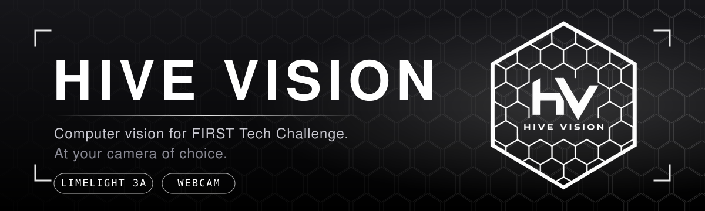
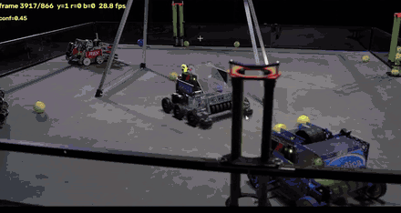
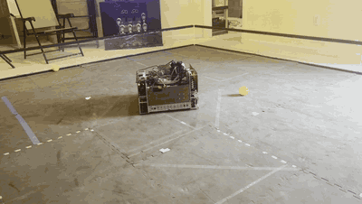
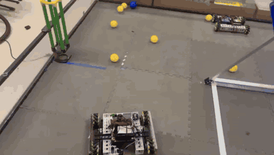
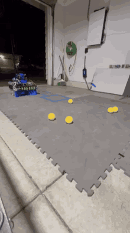
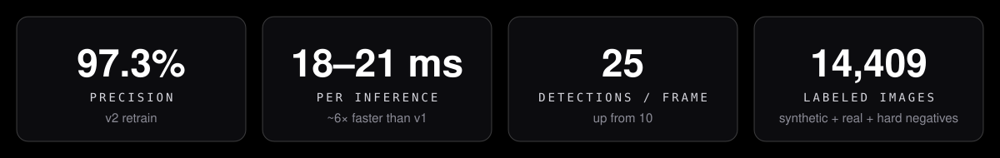
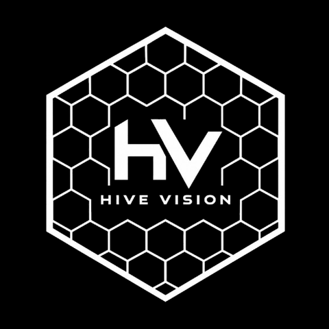

<div align="center">

**[Read the docs](https://hivevisionftc.github.io/HiveVisionDocs/)** · **[Join the Discord](https://discord.gg/jfj54TUmPT)**

[](https://hivevisionftc.github.io/HiveVisionDocs/)
[](https://discord.gg/jfj54TUmPT)
[](https://github.com/hivevisionftc/Hive-Vision/releases/latest)



</div>

---

## What is Hive Vision?

Ball tracking for FTC that works with the camera you already have. Built and tested by students and teams in the community.

| Camera | How it works | Pick it if | Setup |
| --- | --- | --- | --- |
| **Limelight 3A** | A neural network runs on the camera's own processor | You want the steadiest tracking in matches | [Guide](https://hivevisionftc.github.io/HiveVisionDocs/installation/limelight/) |
| **Webcam** | Colour thresholding on the Control Hub, no model | You want to try it today or prototype | [Guide](https://hivevisionftc.github.io/HiveVisionDocs/installation/webcam/) |

Have both? Start with the Limelight.

## See it work

<table>
  <tr>
    <td align="center" valign="top"></td>
    <td align="center" valign="top"></td>
  </tr>
  <tr>
    <td align="center" valign="top"><b>Neural detection</b><br>Pollen and nectar, found live</td>
    <td align="center" valign="top"><b>Auto-chase</b><br>Limelight 3A, by 47 Beavers (13100)</td>
  </tr>
  <tr>
    <td align="center" valign="top"></td>
    <td align="center" valign="top"></td>
  </tr>
  <tr>
    <td align="center" valign="top"><b>Webcam chase</b><br>By Owen Cassidy (17113, Hunga Munga)</td>
    <td align="center" valign="top"><b>Spline pathing</b><br>Limelight 3A + PedroPathing, by Ajay Govindarajan (22297, Infinibots)</td>
  </tr>
</table>

## Get started

Everything lives in the [docs](https://hivevisionftc.github.io/HiveVisionDocs/).

- **New here?** Read the [overview](https://hivevisionftc.github.io/HiveVisionDocs/overview/overview/).
- **Example OpModes:** [Limelight driving](https://hivevisionftc.github.io/HiveVisionDocs/reference/teleop) · [Limelight pathing](https://hivevisionftc.github.io/HiveVisionDocs/reference/auto) · [Webcam driving](https://hivevisionftc.github.io/HiveVisionDocs/reference/webcamteleop)
- **Stuck?** Ask in the [Discord](https://discord.gg/jfj54TUmPT).

<details>
<summary><b>Webcam code example</b></summary>

```java
BallDetectorPipeline baller = new BallDetectorPipeline();

VisionPortal portal = new VisionPortal.Builder()
        .setCamera(hardwareMap.get(WebcamName.class, "Webcam 1"))
        .setCameraResolution(new Size(1280, 720))
        .addProcessor(baller)
        .enableLiveView(true)
        .build();

BallDetectorPipeline.BallBlob red = baller.bestOf(BallDetectorPipeline.BallColor.RED);
if (red != null) {
    telemetry.addData("red", "cx=%.2f cy=%.2f", red.cxNorm, red.cyNorm);
}
```

`bestOf(...)` returns `null` when nothing of that colour passes the checks. Otherwise it returns a `BallBlob` with `cxNorm` and `cyNorm` (0 to 1, relative to the screen). Colours: `YELLOW`, `RED`, `BLUE`.

</details>

---

## The model




v2 is fully 8-bit and about 6× faster than v1. It was trained on hard negatives like shadows, wiring and signage, so it sees fewer balls that aren't there. Class order and FTC-side code are unchanged from v1, so upgrading means swapping one file.

> **Reading the raw outputs?** Only trust slots where `i < num_detections[0]`. Anything past that is uninitialized memory.

<details>
<summary><b>Model details</b></summary>

| | |
| --- | --- |
| File | `best_limelight3a_ssd_mobilenetv2_300x300_v2_int8_dets25.tflite` |
| Architecture | SSD-MobileNetV2, 300 × 300 |
| Input | `uint8 [1,300,300,3]`, scale 1/255 |
| Output | `TFLite_Detection_PostProcess`: `num[1]`, `scores[1,25]`, `class_ids[1,25]`, `boxes[1,25,4]` (normalized `ymin,xmin,ymax,xmax`), float32 |
| Max detections | 25 |
| Size | 5.19 MB |

**Why 25 detections?** The model keeps the top-N boxes after score filtering. With N=10, a frame with 14 balls could only report 10. A cap of 25 gives crowded scenes room, and sparse frames don't change (about 4 detections per frame on average in validation).

</details>

<details>
<summary><b>How it was built</b></summary>

SSD-MobileNetV2 (300×300) was trained with the TensorFlow Object Detection API for 30,000 steps on an RTX 3000 Ada, using a class-weighted loss and baked-in NMS thresholds (score 0.3, IoU 0.6, 20 per class, 20 total). Final total loss was 0.1815, with 97.3% precision.

It was then exported to a SavedModel with a native `uint8` input wrapper and converted to TFLite with full int8 quantization, calibrated on 512 frames sampled evenly across the training set. Weights and activations are 8-bit. Only the post-process outputs stay float32, which is what the Limelight 3A's neural detector expects.

Every release is checked with an output contract test, a latency benchmark, and a validation A/B against the previous model.

</details>

<details>
<summary><b>Dataset</b></summary>

14,409 labeled images (11,895 train, 2,514 validation): synthetic CAD renders of the game balls, real match and arena footage, and hard-negative frames.

Community datasets used:

| Dataset | Author | License |
| --- | --- | --- |
| [FTC-BioBuzz](https://universe.roboflow.com/bluedarkup/ftc-biobuzz-6vjbl) | Bluedarkup on Roboflow | MIT |
| [Chunc Pollen](https://universe.roboflow.com/arushs-workspace/chunc-pollen-l3rnm-wcueq) | Arush's Workspace on Roboflow | CC BY 4.0 |

</details>

## Tested on real robots

| ProBotiX v2 testing | Arush v2 testing |
| --- | --- |
|  |  |
| Recorded by Team 16765 ProBotiX | Recorded by Arush, FTC 23511 |

## What's new

- **[v2.0.0](https://github.com/hivevisionftc/Hive-Vision/releases/tag/v2.0.0):** up to 25 detections per frame, full int8 (about 6× faster), a bigger and harder dataset, 97.3% precision. No code changes needed from v1.
- **[v1.1.0](https://github.com/hivevisionftc/Hive-Vision/releases/tag/v1.1.0):** retrained on about 10,000 images. Shadows and off-field objects are no longer detected as game elements.

## Team

Hive Vision was started by **[Harjas Sidhu](https://github.com/sidhuharjas)**, the founder and lead developer. **[Sid Shah](https://github.com/KnowPa1n)** is a co-developer.

Thanks to the teams who tested it: **Arush** (23511a), **Ajay Govindarajan** (22297), **47 Beavers** (13100), **Owen Cassidy** (17113), **ProBotiX** (16765), **Javi Nashat** (23286) and **Jasper Wolves Blue** (11419). Their field reports are the reason v1.1 and v2 exist.

## Community

Join the [Discord](https://discord.gg/jfj54TUmPT) to share robot tests, training data, detector results and setup questions. Bugs, suggestions and dataset contributions can go in a [GitHub issue](https://github.com/hivevisionftc/Hive-Vision/issues).

- **Updates:** a release or model update is planned about every other week all season, with new weights, HSV settings, eval results and demo samples.
- **Training data:** share a link in the Discord's training-data discussion, with the source, camera resolution, frame rate, lighting and permission to use it. See the [training data guide](docs/training_data.md).
- **Code:** see [CONTRIBUTING.md](CONTRIBUTING.md).
- **Certificates:** contributors whose data or testing work is accepted can request a certificate for their specific contribution, such as data collection, labeling, evaluation or detector testing. It's fine for a portfolio or resume, and it doesn't imply authorship of the whole project. Ask in an issue or the Discord.

## License

Original Hive Vision code, documentation and configuration are MIT. See [LICENSE](https://github.com/hivevisionftc/Hive-Vision/blob/main/LICENSE). YOLO model artifacts and Ultralytics-dependent material are AGPL-3.0. See [THIRD_PARTY_NOTICES.md](https://github.com/hivevisionftc/Hive-Vision/blob/main/THIRD_PARTY_NOTICES.md).

<br>

<div align="center">



</div>
